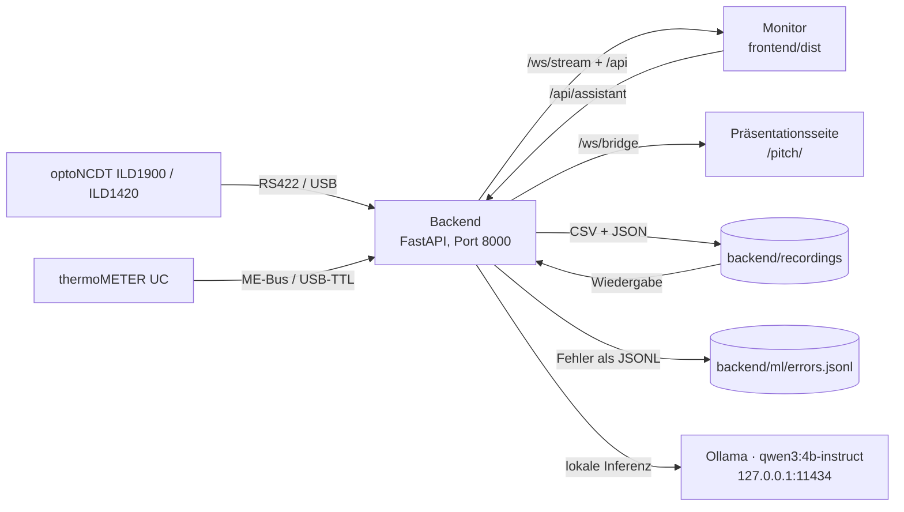

# Micro-Epsilon · Sensor Monitor

Live-Messplatz für den optoNCDT 1900-10 und thermoMETER UC mit Diagramm, Aufzeichnung und CSV-/PDF-Export. Die Anzeige und Messprofile wechseln passend zum Sensor zwischen mm und °C; gespeicherte Aufzeichnungen behalten ihre Einheit.

## Start

Python 3.10 oder neuer muss installiert sein. Im Repository:

```sh
./start.sh
```

Der erste Start installiert die Python-Abhängigkeiten in `backend/.venv`.
Öffne anschließend **http://127.0.0.1:8000/** und klicke auf **Sensor verbinden**.
Der Anschluss wird automatisch gefunden; bei mehreren USB-Geräten wählst du Anschluss und Sensortyp aus.
Schließe vorher sensorTOOL oder andere Programme, die denselben Sensor verwenden.
Eine bereits aktive Backend-Verbindung wird beim Öffnen sofort angezeigt.

Das Dashboard verwendet standardmäßig echte Sensordaten. Ohne Messserver oder Sensor
zeigt es den Verbindungsstatus; die Demo lässt sich über die Datenquellenauswahl aktivieren.
Wiedergaben sind als solche gekennzeichnet. Bei ungültigem Signal erscheint kein alter
Messwert. Nach einem Verbindungsabbruch versucht der Monitor, sich erneut zu verbinden.

Dashboard, API und WebSocket laufen auf demselben Server. Mit Strg+C beendest du ihn;
der Sensor erhält dabei seine ursprünglichen Ausgabeeinstellungen zurück.
Die separate Diagnoseansicht liegt unter http://127.0.0.1:8000/diagnostics/.
Die neue Präsentationsseite erreichst du unter http://127.0.0.1:8000/pitch/.

## Sensoren

| Sensor | Misst | Anschluss | Stand |
|---|---|---|---|
| optoNCDT ILD1900-10 | Abstand, 20 bis 30 mm vor der Sensorfront | RS422-USB-Wandler | am Gerät geprüft, bis 10 kHz |
| optoNCDT ILD1420-50 | Abstand, 35 bis 85 mm | RS422-USB-Wandler | am Gerät geprüft, bis 4 kHz (dieses Exemplar) |
| thermoMETER UC (UC-SF22-S3) | Oberflächentemperatur, -50 bis 900 °C | 3,3-V-TTL-USB-Kabel, ME-Bus | am Gerät geprüft, etwa 55 Werte/s, Einstellungen nur lesbar |
| Simulator, Aufzeichnungen | | keiner | für Entwicklung und Demo ohne Hardware |

Welcher Sensor an welchem USB-Anschluss hängt, beantwortet `GET /api/sensors/scan?probe=true`; jeder Anschluss wird
dabei nur lesend gefragt. `POST /api/connect` mit `{"sensor":"AUTO"}` verbindet den ersten Sensor, der antwortet.

## Gerätecheck und Handy-Ansicht

`backend/device.py` prüft, welches Gerät verbunden ist (Modell, Einheit, Messbereich, Treiber) und ob es ein echter
Sensor, der Simulator oder eine Aufzeichnung ist. Das Ergebnis steht als `device` in `/api/status`, in jedem Frame und
unter `GET /api/device`. Monitor und Handy-Ansicht zeigen ein Gerät nur, wenn es geprüft ist und ein Layout dafür
existiert (Abstand mit 3D-Sensor und LEDs, oder Temperatur); unbekannte oder widersprüchliche Geräte werden abgewiesen.

Beim Start mit `./start.sh` erscheint im Terminal **Handy im gleichen WLAN** mit der aktuellen Adresse.
Im Desktop-Cockpit findest du den Link unter **Einstellungen → Verbindung → Auf dem Handy öffnen**.
Verbinde das Handy mit demselben WLAN wie den Sensor-PC und öffne die Adresse im Handy-Browser.
**PC-Messung** startet automatisch und zeigt den Messdatenstrom des am PC aktiven Sensors. Am PC ist die mobile Ansicht auch unter
http://127.0.0.1:8000/handy/ erreichbar.

Läuft der Messserver bereits einzeln, starte zusätzlich `python3 "frontend/Handy frontend/serve.py"`.
Für einen anderen Messserver-Port ergänze beispielsweise `--backend-port 8001`. Der Handy-Server stellt
den Datenstrom und die Lesezugriffe auf Sensorstatus, Gerät und letzten Messwert bereit.

## KI-Anomalieerkennung

Der Messserver lernt nach dem Verbinden etwa 10 s lang, wie das Signal des Sensors normal aussieht (oder aus einer
Aufnahme: Einstellungen → „Aufnahme als Normalzustand lernen“). Weicht das Signal danach ab, erscheint auf dem
Messplatz eine KI-Auffälligkeit mit Grund, z. B. „Messwert verschoben“ oder „Rauschen erhöht“:
- **In Ordnung**: Das Muster gilt als normal und wird nicht mehr gemeldet.
- **Nicht in Ordnung**: Das Muster gilt als Anomalie und wird künftig direkt als bekannte Anomalie erkannt.
- **Fehler** (zu viele ungültige oder verlorene Messwerte, Wert außerhalb der eingestellten Grenzen) werden verworfen,
  nie gelernt und als JSON-Zeile in `backend/ml/errors.jsonl` geschrieben, damit andere Programme sie weiterverarbeiten.

**Schwarzes Metall als Anomalie:** Sensor verbinden, dann `cd backend && .venv/bin/python teach_materials.py`.
Das Skript lernt alle ILD1900-Aufnahmen als normal und schwarzes Metall als Anomalie (Erkennungsmerkmal: geringe
Signalstärke). Liegt danach schwarzes Metall unter dem Sensor, erscheint „Anomalie erkannt · black-metal“. Einzelne
Aufnahmen lassen sich auch unter Einstellungen mit „Als normal lernen“ / „Als Anomalie lernen“ beibringen.

Alle Parameter (Meldeschwelle, Zeitfenster, Lernphase, Grenzen, Fehlerdatei …) stehen unter **Einstellungen →
KI-Anomalieerkennung**. Das Gelernte bleibt pro Sensor in `backend/ml/` gespeichert. Details: [API](backend/API.md#anomaly-agent-anomalypy).

## Lokaler Sprachassistent

Der Assistent beantwortet Fragen zur App und erklärt die ausdrücklich übergebenen Fehler und Diagrammdaten über
Ollama mit `qwen3:4b-instruct`. Ein Cloud-Key ist nicht erforderlich. Parameterbefehle erzeugen ausschließlich
simulierte Vorschläge; sie ändern weder Sensor noch Messprofil oder ML-Einstellungen.

Ollama muss bereits installiert sein. Einmal mit Internetzugang das Modell einrichten, danach lokal starten:

```sh
./scripts/start-assistant.sh setup
./scripts/start-assistant.sh start
export ASSISTANT_OLLAMA_URL=http://127.0.0.1:11434
export ASSISTANT_MODEL=qwen3:4b-instruct
./start.sh
```

Nur `setup` lädt das Modell herunter. `start` verwendet ein vorhandenes Modell und einen erreichbaren Dienst weiter
oder startet einen lokalen Ollama-Prozess. `status` prüft beides ohne Start oder Download. Der normale
Messserverstart bleibt unverändert. Unter macOS wird auch die CLI in einer vorhandenen `Ollama.app` gefunden.
Ein bereits laufender Dienst behält seine Cloud-Konfiguration; neu gestartetes Ollama erhält `OLLAMA_NO_CLOUD=1`.

Das Assistentenwissen stammt aus der App und ihrem Sensorkontext. Herstellerhandbücher und ein Handbuch-RAG-Index
sind in diesem Checkout nicht enthalten. Einrichtung, Offlineprobe, vollständiger Modelldigest und Benchmarkverfahren:
[Lokaler Sensor-Assistent](backend/ASSISTANT.md).

## Aufbau



| Ordner | Inhalt |
|---|---|
| `backend/` | Messserver: API, Sensortreiber (`sources.py`), KI-Anomalieerkennung (`anomaly.py`), Aufzeichnungen, `record_materials.py` für geführte Materialaufnahmen ([Backend](backend/README.md), [API](backend/API.md)) |
| `frontend/` | Monitor (Messplatz, `dist/`) und Handy-Ansicht (`Handy frontend/`) ([Frontend](frontend/README.md)) |
| `scrollcraft/builds/landing/` | Präsentationsseite für den Pitch, zehn Sprachen ([README](scrollcraft/builds/landing/README.md)) |
| `backend/recordings/` | Beispielaufnahmen des ILD1900 (sechs Materialien) zum Abspielen ohne Hardware |
| `scripts/start-assistant.sh` | Lokaler Ollama-Dienst: expliziter Modelldownload, Start und Statusprüfung ([Anleitung](backend/ASSISTANT.md)) |

Gut zu wissen:
- Solange ein optoNCDT verbunden ist, ist sein analoger 4-20-mA-Ausgang aus (die Daten laufen über RS422).
  Trennen oder Strg+C stellt ihn wieder her; nach einem gezogenen Kabel geschieht das beim nächsten Verbinden.
- Das thermoMETER-Protokoll stammt aus dem Trace-Log der MEDAQLib in `software/MEDAQLib_samples/` und wurde am Sensor
  geprüft. Emissionsgrad und Mittelung lassen sich von hier aus noch nicht ändern.
- Die 3D-Modelle im Monitor werden separat gepflegt.

## Prüfen

```sh
npm test --prefix frontend
backend/.venv/bin/pip install -r backend/requirements-dev.txt
(cd backend && .venv/bin/python -m unittest discover -s tests -v)
```

Weitere Details: [Frontend](frontend/README.md), [Backend](backend/README.md), [API](backend/API.md).
