# Micro-Epsilon · Sensor Monitor

Live-Messplatz für den optoNCDT 1900-10 und thermoMETER UC mit Diagramm, Aufzeichnung und CSV-/PDF-Export. Die Anzeige und Messprofile wechseln passend zum Sensor zwischen mm und °C; gespeicherte Aufzeichnungen behalten ihre Einheit.

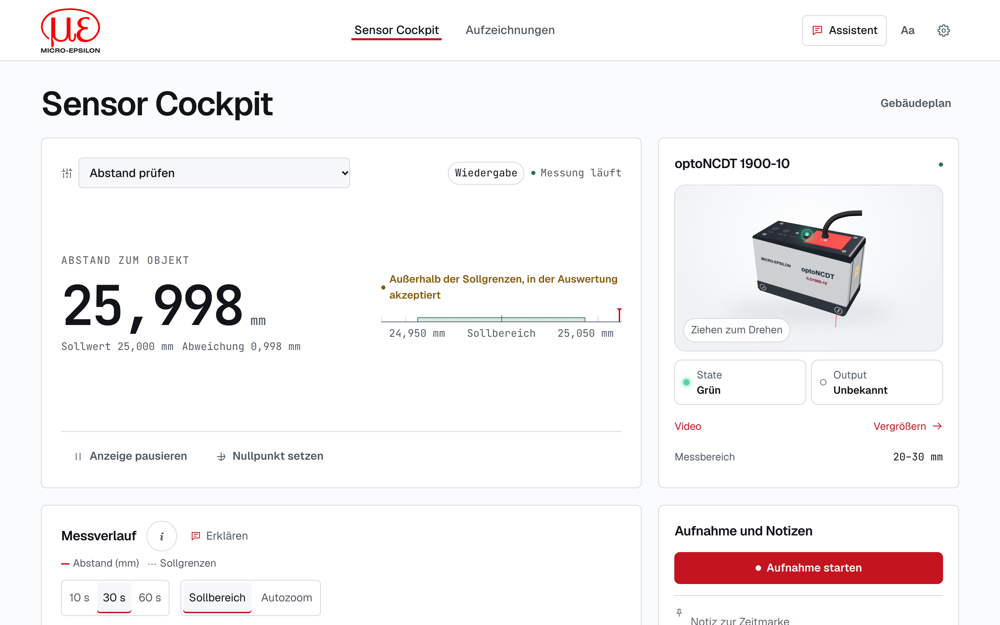

## In Bildern

### Sensor Cockpit

Messwert, Sollbereich, Verlauf, 3D-Modell des Sensors mit seinen LEDs, Aufnahme und Notizen auf einer Seite. Hell und
dunkel, in zehn Sprachen. Die Screenshots zeigen die Wiedergabe echter ILD1900-Aufnahmen.

| Hell | Dunkel |
|---|---|
|  | 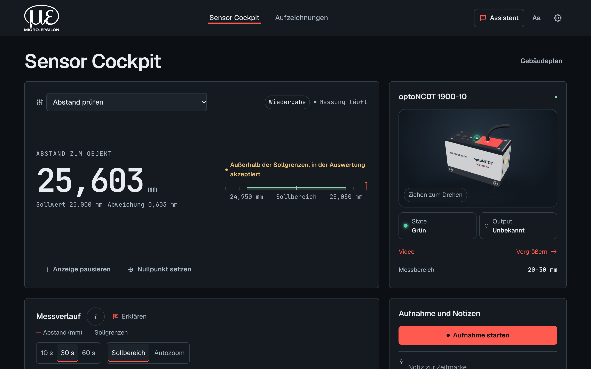 |

### Gebäudeplan mit Modulen und Alarmen

Herausgezoomt der Plan der Halle, hineingezoomt eine Kachel je Station, in ihrer Lage auf dem Plan. Ein Modul im Alarm
blinkt rot und landet mit Ton in „Erkannte Fehler“; nach dem Ausschlag bleibt es markiert, bis jemand quittiert. Ein
angeschlossener Sensor speist das Modul mit **LIVE**-Markierung, die übrigen sind simuliert.

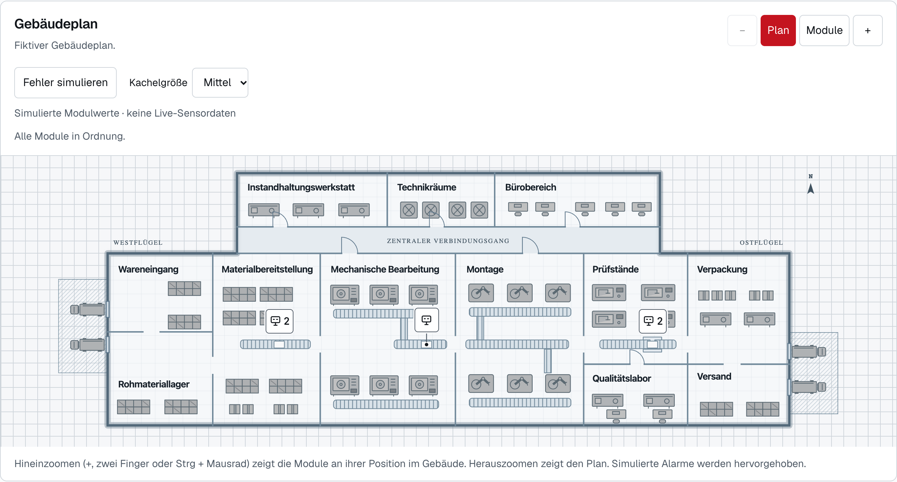
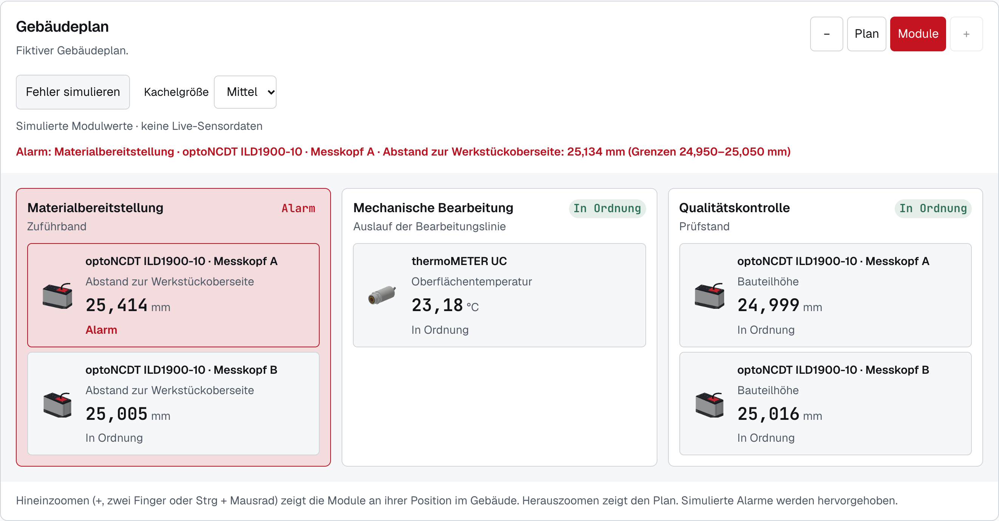

### Saalansicht für Beamer

Das **Aa** oben rechts (oder Einstellungen → Anzeige → Schriftgröße) vergrößert die ganze Oberfläche um das 1,5-Fache,
damit sie auch aus der letzten Reihe lesbar ist. Diagramme bleiben scharf, die Wahl wird im Browser gespeichert.

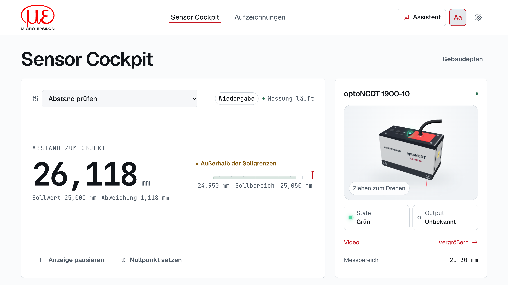

### Handy-Ansicht

Unter `/handy/`, im gleichen WLAN auch auf dem Handy (siehe [Handy-Ansicht](#gerätecheck-und-handy-ansicht)). Mit
angeschlossenem Sensor öffnet sie direkt die Live-Daten.

| Hell | Gebäudeplan | Dunkel |
|---|---|---|
| 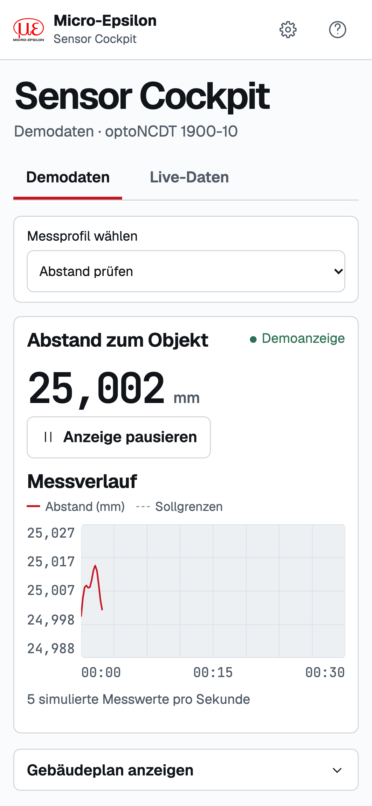 | 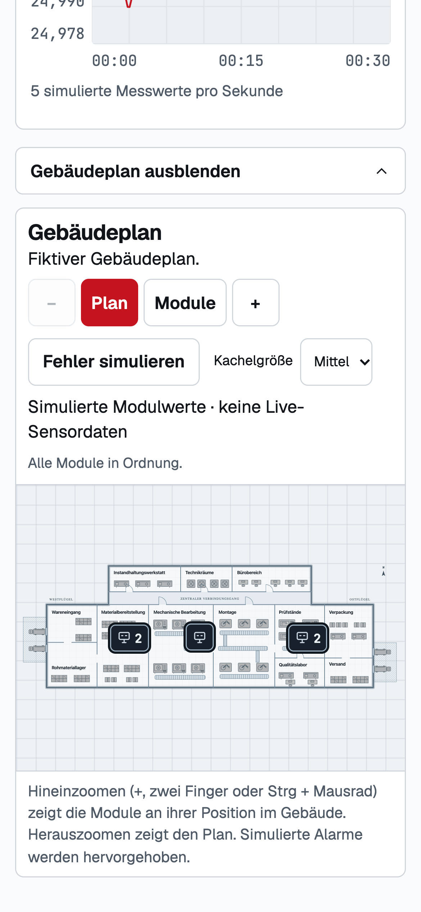 | 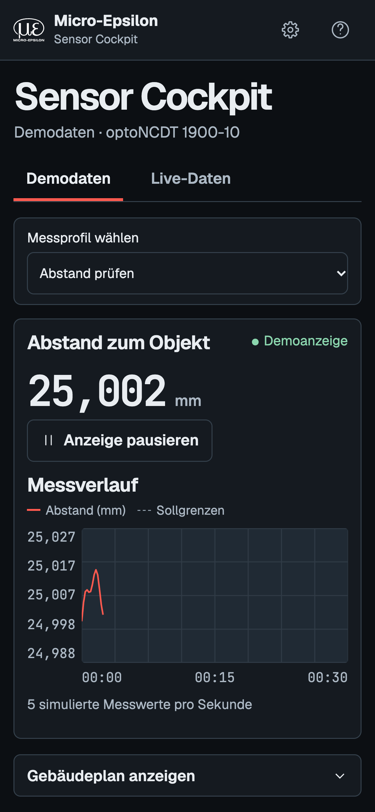 |

### Aufzeichnungen und Einstellungen

| Aufzeichnungen | Einstellungen |
|---|---|
| 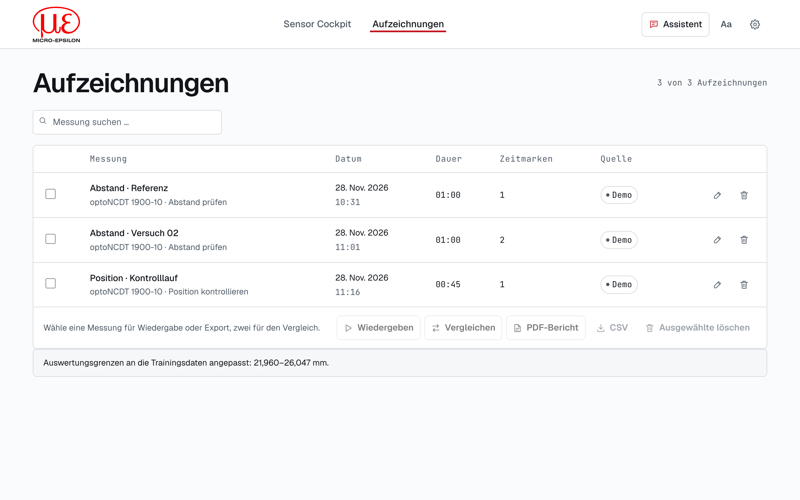 | 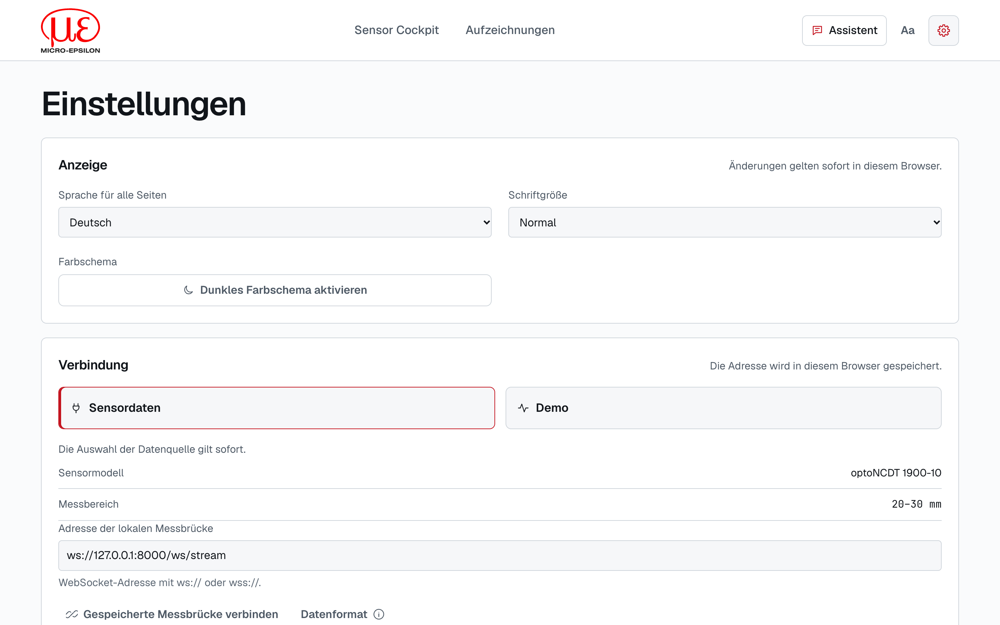 |

### Video: Lasermodul tauschen (schematisch)

Eine 31 Sekunden lange Animation am 3D-Modell des ILD1900: Spannung trennen, vier Deckelschrauben lösen, Deckel
abheben, Flexkabel lösen, zwei Modulschrauben lösen, Lasermodul entnehmen. Im Cockpit öffnet „Video“ an der
Sensorkarte dieselbe Datei. Das Innere ist erfunden: Der echte ILD1900 ist ein geschlossenes Gerät, das Video ist
**keine offizielle Reparaturanleitung**.

[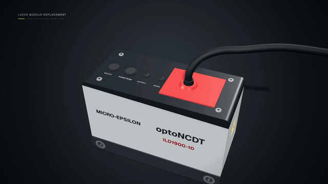](frontend/dist/assets/videos/ILD1900-teardown.mp4)

[Video ansehen (MP4, 1080p, 60 fps, 11 MB)](frontend/dist/assets/videos/ILD1900-teardown.mp4)

## Installation

### Was du brauchst

| | Pflicht? | Wofür |
|---|---|---|
| **Python 3.10 oder neuer** | ja | Messserver. Prüfen mit `python3 --version` (Windows: `py --version`) |
| Internet beim ersten Start | ja, einmal | lädt die Python-Pakete (FastAPI, Uvicorn, pySerial, httpx) |
| Webbrowser | ja | Chrome, Edge, Firefox oder Safari in aktueller Version |
| Sensor mit USB-Wandler | nein | ohne Sensor laufen Demo und die mitgelieferten Aufnahmen |
| Git | nein | nur zum Herunterladen und Aktualisieren per `git` |
| Node.js 20 oder neuer | nein | nur für die automatischen Tests |
| Ollama | nein | nur für den lokalen Sprachassistenten ([unten](#lokaler-sprachassistent)) |

Python installieren, falls `python3 --version` nichts oder eine ältere Version meldet:
- **macOS:** Installer von [python.org/downloads](https://www.python.org/downloads/) oder `brew install python`.
- **Windows:** Installer von [python.org/downloads](https://www.python.org/downloads/); im ersten Fenster
  **„Add python.exe to PATH“** anhaken.
- **Linux (Debian, Ubuntu):** `sudo apt install python3 python3-venv`.

### 1. Programm herunterladen

Mit Git:

```sh
git clone https://github.com/ABChanakya/hackathon-micron-epsilon.git
cd hackathon-micron-epsilon
```

Ohne Git: auf GitHub **Code → Download ZIP**, entpacken und im Terminal in den entpackten Ordner wechseln.

### 2. Starten

**macOS und Linux** (Terminal, im Programmordner):

```sh
./start.sh
```

**Windows** (Doppelklick auf `start.bat` oder in der Eingabeaufforderung im Programmordner):

```bat
start.bat
```

Der erste Start dauert etwa eine Minute: Das Skript legt die Python-Umgebung in `backend/.venv` an und installiert die
Pakete dorthin; am übrigen System ändert es nichts. Jeder weitere Start geht in Sekunden. Erscheint
`Micro-Epsilon Live-Monitor: http://127.0.0.1:8000/`, läuft der Messserver. Das Fenster bleibt offen, solange du
misst; **Strg+C** beendet ihn.

### 3. Öffnen und Sensor verbinden

1. Öffne **http://127.0.0.1:8000/** im Browser.
2. Schließe sensorTOOL und andere Programme, die denselben Sensor verwenden.
3. Stecke den Sensor per USB-Wandler an und klicke auf **Sensor verbinden**. Der Anschluss wird automatisch
   gefunden; bei mehreren USB-Geräten wählst du Anschluss und Sensortyp aus. Unter Windows heißt er `COM3` o. Ä.;
   welcher es ist, zeigt der Geräte-Manager unter „Anschlüsse (COM & LPT)“.
4. Ohne Sensor: unter **Datenquelle** die Demo oder **Echte Aufnahmen abspielen** wählen.

Eine bereits aktive Backend-Verbindung wird beim Öffnen sofort angezeigt.

### Handy verbinden (optional)

Handy und Rechner müssen im selben Netz sein, im WLAN oder über den Hotspot des Handys, mit dem sich der Rechner
verbindet. Während der Messserver läuft, in einem zweiten Terminal:

```sh
python3 "frontend/Handy frontend/serve.py"
```

Dann auf dem Handy `http://<IP-Adresse des Rechners>:4174/` öffnen. Die IP-Adresse zeigt `ipconfig getifaddr en0`
(macOS), `hostname -I` (Linux) oder `ipconfig` beim WLAN-Adapter (Windows). Fragt die Firewall, ob Python
Verbindungen annehmen darf, erlaube es für private Netze. Das Handy kann nur lesen: Der Handy-Server gibt nur
Messwerte und Gerätestatus weiter, keine Einstellungen.

### Aktualisieren und Entfernen

- **Aktualisieren:** `git pull` (oder neues ZIP), dann wie gewohnt starten; neue Pakete werden dabei installiert.
  Im Browser einmal **Strg+Shift+R** (macOS: **Cmd+Shift+R**), damit er die neuen Dateien lädt.
- **Entfernen:** den Programmordner löschen. Python-Pakete, Aufnahmen (`backend/recordings/`) und Gelerntes der KI
  (`backend/ml/`) liegen alle darin; sichere sie vorher, wenn du sie behalten willst.

### Wenn etwas nicht klappt

| Problem | Lösung |
|---|---|
| `python3: command not found` oder `py` unbekannt | Python installieren (siehe oben), Terminal neu öffnen |
| `./start.sh: Permission denied` | `sh start.sh` verwenden oder einmal `chmod +x start.sh` |
| `ensurepip is not available` (Linux) | `sudo apt install python3-venv`, dann den Ordner `backend/.venv` löschen und neu starten |
| `address already in use` / Port 8000 belegt | läuft der Messserver schon in einem anderen Fenster? Sonst `./start.sh --port 8001` und http://127.0.0.1:8001/ öffnen |
| Sensor wird nicht gefunden | USB-Kabel prüfen, sensorTOOL schließen, anderen USB-Anschluss versuchen; unter macOS zeigt `ls /dev/cu.usbserial*` den Wandler |
| Linux: „Permission denied“ am Anschluss | `sudo usermod -aG dialout $USER`, abmelden und wieder anmelden |
| „Datenquelle getrennt · Device not configured“ | das USB-Kabel war kurz weg; einstecken und **Erneut verbinden** |
| Handy erreicht den Rechner nicht | gleiches Netz? Gäste- und Uni-WLANs (eduroam) trennen Geräte oft voneinander; dann den Handy-Hotspot nutzen |
| Seite sieht nach einem Update alt aus | **Strg+Shift+R** bzw. **Cmd+Shift+R** |

Getestet ist der Messplatz unter macOS mit echten Sensoren. Linux und Windows (`start.bat`) folgen denselben Schritten,
sind mit angeschlossenem Sensor aber nicht geprüft.

Das Dashboard verwendet standardmäßig echte Sensordaten. Ohne Messserver oder Sensor
zeigt es den Verbindungsstatus; die Demo lässt sich über die Datenquellenauswahl aktivieren.
Wiedergaben sind als solche gekennzeichnet. Bei ungültigem Signal erscheint kein alter
Messwert. Nach einem Verbindungsabbruch versucht der Monitor, sich erneut zu verbinden.

Dashboard, API und WebSocket laufen auf demselben Server. Mit Strg+C beendest du ihn;
der Sensor erhält dabei seine ursprünglichen Ausgabeeinstellungen zurück.
Die separate Diagnoseansicht liegt unter http://127.0.0.1:8000/diagnostics/.
Die neue Präsentationsseite erreichst du unter http://127.0.0.1:8000/pitch/.

## Sensoren

| Sensor | Misst | Anschluss | Stand |
|---|---|---|---|
| optoNCDT ILD1900-10 | Abstand, 20 bis 30 mm vor der Sensorfront | RS422-USB-Wandler | am Gerät geprüft, bis 10 kHz |
| optoNCDT ILD1420-50 | Abstand, 35 bis 85 mm | RS422-USB-Wandler | am Gerät geprüft, bis 4 kHz (dieses Exemplar) |
| thermoMETER UC (UC-SF22-S3) | Oberflächentemperatur, -50 bis 900 °C | 3,3-V-TTL-USB-Kabel, ME-Bus | am Gerät geprüft, etwa 55 Werte/s, Einstellungen nur lesbar |
| Simulator, Aufzeichnungen | | keiner | für Entwicklung und Demo ohne Hardware |

Welcher Sensor an welchem USB-Anschluss hängt, beantwortet `GET /api/sensors/scan?probe=true`; jeder Anschluss wird
dabei nur lesend gefragt. `POST /api/connect` mit `{"sensor":"AUTO"}` verbindet den ersten Sensor, der antwortet.

## Gerätecheck und Handy-Ansicht

`backend/device.py` prüft, welches Gerät verbunden ist (Modell, Einheit, Messbereich, Treiber) und ob es ein echter
Sensor, der Simulator oder eine Aufzeichnung ist. Das Ergebnis steht als `device` in `/api/status`, in jedem Frame und
unter `GET /api/device`. Monitor und Handy-Ansicht zeigen ein Gerät nur, wenn es geprüft ist und ein Layout dafür
existiert (Abstand mit 3D-Sensor und LEDs, oder Temperatur); unbekannte oder widersprüchliche Geräte werden abgewiesen.

Die Handy-Ansicht liegt in `frontend/Handy frontend/`. Am Rechner: http://127.0.0.1:8000/handy/. Auf dem Handy (gleiches
WLAN): `python3 "frontend/Handy frontend/serve.py"` und die Adresse aus dem README dort öffnen. Der Handy-Server leitet
nur `/api/status`, `/api/latest` und `/api/device` lesend an den Messserver weiter.

## Fabrikplan

Der Messplatz (unter dem Messbereich) und die Handy-Ansicht zeigen einen fiktiven Fabrikplan. Herausgezoomt ist es der
Hallenplan, hineingezoomt eine Kachel je Station in ihrer Lage auf dem Plan. Ein angeschlossener echter Sensor speist ein
Modul (ILD1900: Qualitätskontrolle · Messkopf A, thermoMETER: Mechanische Bearbeitung, mit **LIVE** markiert); dessen Alarm
kommt von der KI oder einem ungültigen Messwert. Die übrigen Module sind simuliert; **Fehler simulieren** lässt einen davon
ausschlagen. Module im Alarm blinken rot, bis sie quittiert sind. Alarme der simulierten Module erscheinen im Cockpit
unter „Erkannte Fehler“ (mit Alarmton). Der Plan folgt dem hellen oder dunklen Farbschema. Code:
`frontend/Handy frontend/fabrikplan/` (Plan, Module, Live-Modul), `frontend/dist/factory-plan.js` (Einbindung ins Cockpit).

## KI-Anomalieerkennung

Der Messserver lernt nach dem Verbinden etwa 10 s lang, wie das Signal des Sensors normal aussieht (oder aus einer
Aufnahme: Einstellungen → „Aufnahme als Normalzustand lernen“). Weicht das Signal danach ab, erscheint auf dem
Messplatz eine KI-Auffälligkeit mit Grund, z. B. „Messwert verschoben“ oder „Rauschen erhöht“:
- **In Ordnung**: Das Muster gilt als normal und wird nicht mehr gemeldet.
- **Nicht in Ordnung**: Das Muster gilt als Anomalie und wird künftig direkt als bekannte Anomalie erkannt.
- **Fehler** (zu viele ungültige oder verlorene Messwerte, Wert außerhalb der eingestellten Grenzen) werden verworfen,
  nie gelernt und als JSON-Zeile in `backend/ml/errors.jsonl` geschrieben, damit andere Programme sie weiterverarbeiten.

**Schwarzes Metall als Anomalie:** Sensor verbinden, dann `cd backend && .venv/bin/python teach_materials.py`.
Das Skript lernt alle ILD1900-Aufnahmen als normal und schwarzes Metall als Anomalie (Erkennungsmerkmal: geringe
Signalstärke). Liegt danach schwarzes Metall unter dem Sensor, erscheint „Anomalie erkannt · black-metal“. Einzelne
Aufnahmen lassen sich auch unter Einstellungen mit „Als normal lernen“ / „Als Anomalie lernen“ beibringen.

Alle Parameter (Meldeschwelle, Zeitfenster, Lernphase, Grenzen, Fehlerdatei …) stehen unter **Einstellungen →
KI-Anomalieerkennung**. Das Gelernte bleibt pro Sensor in `backend/ml/` gespeichert. Details: [API](backend/API.md#anomaly-agent-anomalypy).

## Lokaler Sprachassistent

Der Assistent beantwortet Fragen zur App und erklärt die ausdrücklich übergebenen Fehler und Diagrammdaten über
Ollama mit `qwen3:4b-instruct`. Ein Cloud-Key ist nicht erforderlich. Parameterbefehle erzeugen ausschließlich
simulierte Vorschläge; sie ändern weder Sensor noch Messprofil oder ML-Einstellungen.

Ollama muss bereits installiert sein. Einmal mit Internetzugang das Modell einrichten, danach lokal starten:

```sh
./scripts/start-assistant.sh setup
./scripts/start-assistant.sh start
export ASSISTANT_OLLAMA_URL=http://127.0.0.1:11434
export ASSISTANT_MODEL=qwen3:4b-instruct
./start.sh
```

Nur `setup` lädt das Modell herunter. `start` verwendet ein vorhandenes Modell und einen erreichbaren Dienst weiter
oder startet einen lokalen Ollama-Prozess. `status` prüft beides ohne Start oder Download. Der normale
Messserverstart bleibt unverändert. Unter macOS wird auch die CLI in einer vorhandenen `Ollama.app` gefunden.
Ein bereits laufender Dienst behält seine Cloud-Konfiguration; neu gestartetes Ollama erhält `OLLAMA_NO_CLOUD=1`.

Das Assistentenwissen stammt aus der App und ihrem Sensorkontext. Herstellerhandbücher und ein Handbuch-RAG-Index
sind in diesem Checkout nicht enthalten. Einrichtung, Offlineprobe, vollständiger Modelldigest und Benchmarkverfahren:
[Lokaler Sensor-Assistent](backend/ASSISTANT.md).

## Aufbau

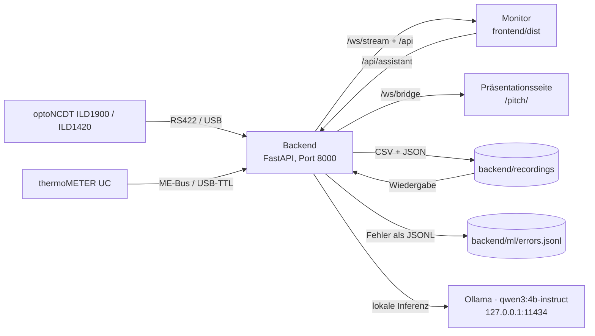

| Ordner | Inhalt |
|---|---|
| `backend/` | Messserver: API, Sensortreiber (`sources.py`), KI-Anomalieerkennung (`anomaly.py`), Aufzeichnungen, `record_materials.py` für geführte Materialaufnahmen ([Backend](backend/README.md), [API](backend/API.md)) |
| `frontend/` | Monitor (Messplatz, `dist/`) und Handy-Ansicht (`Handy frontend/`) ([Frontend](frontend/README.md)) |
| `scrollcraft/builds/landing/` | Präsentationsseite für den Pitch, zehn Sprachen ([README](scrollcraft/builds/landing/README.md)) |
| `backend/recordings/` | Beispielaufnahmen des ILD1900 (sechs Materialien) zum Abspielen ohne Hardware |
| `scripts/start-assistant.sh` | Lokaler Ollama-Dienst: expliziter Modelldownload, Start und Statusprüfung ([Anleitung](backend/ASSISTANT.md)) |

Gut zu wissen:
- Solange ein optoNCDT verbunden ist, ist sein analoger 4-20-mA-Ausgang aus (die Daten laufen über RS422).
  Trennen oder Strg+C stellt ihn wieder her; nach einem gezogenen Kabel geschieht das beim nächsten Verbinden.
- Das thermoMETER-Protokoll stammt aus dem Trace-Log der MEDAQLib in `software/MEDAQLib_samples/` und wurde am Sensor
  geprüft. Emissionsgrad und Mittelung lassen sich von hier aus noch nicht ändern.
- Die 3D-Modelle im Monitor werden separat gepflegt.

## Prüfen

```sh
npm test --prefix frontend
backend/.venv/bin/pip install -r backend/requirements-dev.txt
(cd backend && .venv/bin/python -m unittest discover -s tests -v)
```

Weitere Details: [Frontend](frontend/README.md), [Backend](backend/README.md), [API](backend/API.md).
