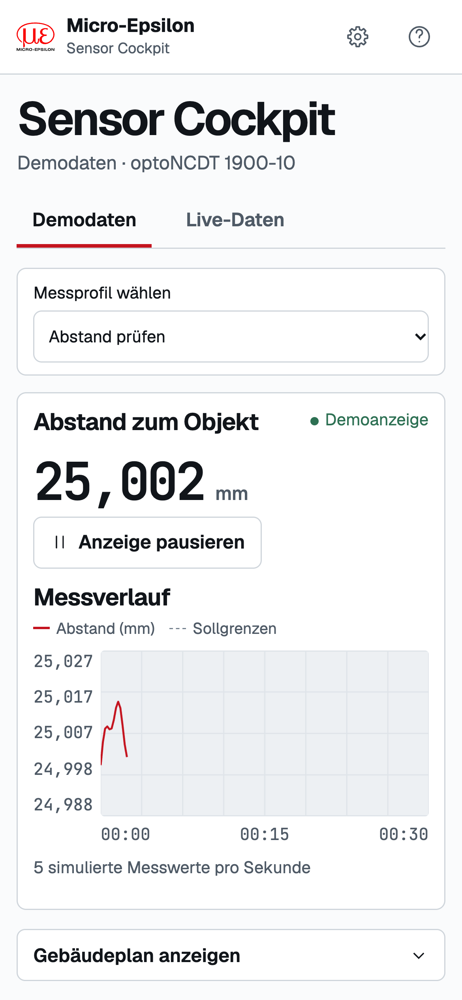
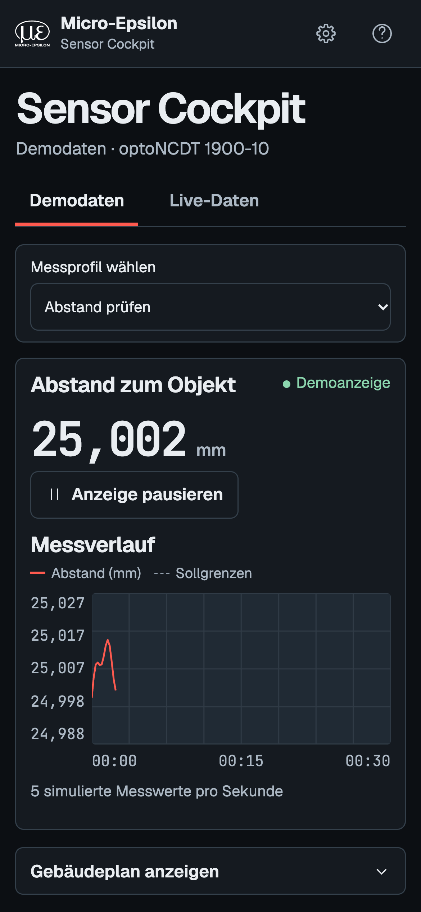
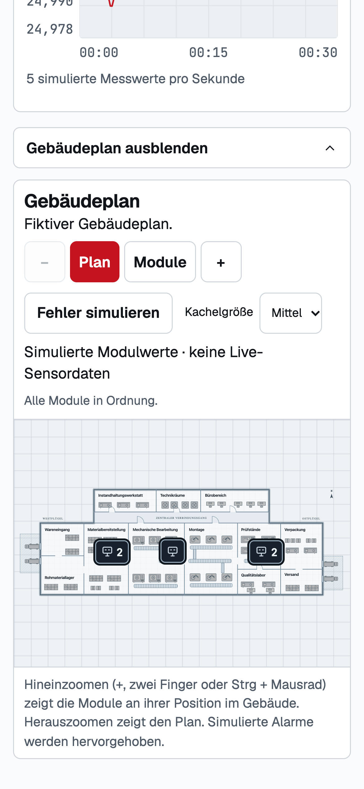
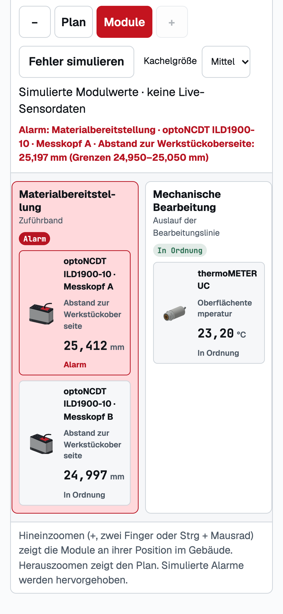
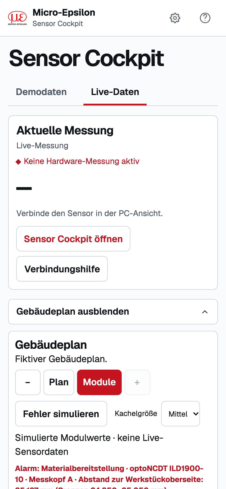
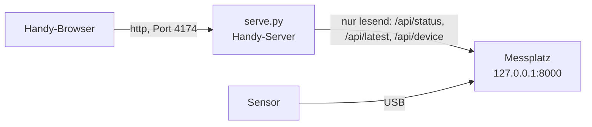

# Micro-Epsilon · Mobiles Sensor Cockpit

Die Handy-Ansicht des Messplatzes: aktueller Messwert und Verlauf der letzten 30 Sekunden, Live-Daten des
angeschlossenen Sensors und der Gebäudeplan mit Modulen und Alarmen. Sie läuft im Browser des Handys, ohne App.
Das Handy liest nur: Einstellungen am Sensor oder am Messplatz lassen sich von hier aus nicht ändern.

| Messansicht (hell) | Messansicht (dunkel) | Gebäudeplan |
|---|---|---|
|  |  |  |

| Module mit Alarm | Live-Daten (hier ohne angeschlossenen Sensor) |
|---|---|
|  |  |

## Installieren und auf dem Handy öffnen

Die Handy-Ansicht gehört zum Messplatz und wird mit ihm installiert. Auf dem Handy wird nichts installiert.

1. **Messplatz einrichten und starten**, wie in der [Installationsanleitung](../../README.md#installation)
   beschrieben (`./start.sh`, unter Windows `start.bat`).
2. **Handy und Rechner ins selbe Netz bringen.** Entweder beide im selben WLAN, oder der Rechner verbindet sich
   mit dem **Hotspot des Handys** (Handy: Einstellungen → Persönlicher Hotspot bzw. Mobiler Hotspot einschalten;
   Rechner: dieses WLAN auswählen). Der Hotspot ist der sichere Weg, wenn das WLAN Geräte voneinander trennt, wie
   eduroam und viele Gäste-WLANs. Für die Verbindung zwischen Handy und Rechner verbraucht er kein Datenvolumen.
3. **Handy-Server starten**, in einem zweiten Terminal im Programmordner, während der Messplatz läuft:

   ```sh
   python3 "frontend/Handy frontend/serve.py"
   ```

   Unter Windows: `py "frontend\Handy frontend\serve.py"`. Fragt die Firewall, ob Python Verbindungen annehmen darf,
   für private Netze erlauben.
4. **IP-Adresse des Rechners herausfinden:**

   | System | Befehl | Typische Adresse im Handy-Hotspot |
   |---|---|---|
   | macOS | `ipconfig getifaddr en0` | iPhone: `172.20.10.x`, Android: `192.168.x.x` |
   | Linux | `hostname -I` (erste Adresse) | wie oben |
   | Windows | `ipconfig`, Zeile „IPv4-Adresse“ beim WLAN-Adapter | wie oben |

5. **Auf dem Handy öffnen:** `http://<IP-Adresse>:4174/`, also zum Beispiel `http://172.20.10.3:4174/`. Wichtig sind
   `http://` (nicht `https://`) und der Port `:4174`.

   Für einen QR-Code: die Adresse am Rechner im Browser öffnen, dann in Chrome **Menü ⋮ → Streamen, speichern und
   teilen → QR-Code erstellen** bzw. in Edge das QR-Symbol in der Adressleiste; das Handy scannt ihn mit der Kamera. Der mitgelieferte `handy-qr.png` enthält eine feste
   Adresse aus einem früheren WLAN und passt nur dort.

Am Rechner selbst ist die Handy-Ansicht ohne zweiten Server unter http://127.0.0.1:8000/handy/ erreichbar.

### Wenn das Handy die Seite nicht lädt

| Problem | Lösung |
|---|---|
| Seite lädt ewig oder „nicht erreichbar“ | Rechner und Handy im selben Netz? Im Hotspot muss der **Rechner** mit dem Handy verbunden sein. Im Uni- oder Gäste-WLAN den Hotspot nutzen |
| Seite lädt, aber „Messserver nicht erreichbar“ | läuft `./start.sh` noch? Der Handy-Server leitet nur weiter und braucht den Messplatz auf Port 8000 |
| Messplatz läuft auf einem anderen Port | `python3 "frontend/Handy frontend/serve.py" --backend-port 8001` |
| Port 4174 ist belegt | `python3 "frontend/Handy frontend/serve.py" --port 4175`, dann `http://<IP>:4175/` öffnen |
| Firewall-Abfrage verpasst | macOS: Systemeinstellungen → Netzwerk → Firewall → Optionen, Python erlauben. Windows: Windows-Sicherheit → Firewall → App zulassen |
| Alte Ansicht nach einem Update | Seite auf dem Handy neu laden; hilft das nicht, die Browserdaten der Seite löschen |

## Was die Ansicht kann

**Demodaten.** Ohne Sensor läuft das Standardprofil „Abstand prüfen“ aus dem Cockpit: dieselbe Formel simuliert fünf
Abstandswerte pro Sekunde um 25 mm, lokal im Browser. Im Dropdown steht derzeit dieser eine Datensatz.

**Live-Daten.** Ist am Rechner ein Sensor verbunden und geprüft, öffnet die Ansicht direkt den Tab **Live-Daten**:
Sensor, aktueller Messwert und Verlauf der letzten 15 Sekunden. Fällt der Server oder der Sensor kurz aus, fragt die
Ansicht selbst erneut nach. Sie zeigt nur Geräte, die der Gerätecheck des Messplatzes bestätigt hat.

**Gebäudeplan: Plan und Module.** Unter **Gebäudeplan anzeigen** zeigt die Gesamtansicht den Hallenplan mit den
Modulen (Stationen). Hineinzoomen (**+**, zwei Finger auseinander, Strg + Mausrad oder Antippen einer Gruppe) wechselt
zur **Modulansicht**: Jede Station wird eine Kachel, und die Kacheln behalten ihre Lage aus dem Plan (was rechts
liegt, bleibt rechts). Herauszoomen (**−**, zwei Finger zusammen) zeigt wieder den Plan. Die Kachelgröße ist
einstellbar (klein, mittel, groß).

- Jede Kachel zeigt ihre Sensoren mit Messwert. Ein angeschlossener echter Sensor speist ein Modul, markiert mit
  **LIVE** (ILD1900: Qualitätskontrolle · Messkopf A, thermoMETER: Mechanische Bearbeitung); sein Alarm kommt von der
  KI des Messplatzes oder von einem ungültigen Messwert. Die übrigen Module sind simuliert.
- Liegt ein Wert außerhalb seiner Grenzen, **blinkt das Modul rot**, im Plan und in der Modulansicht. Nach dem
  Ausschlag bleibt es rot umrandet, bis jemand **Alarm quittieren** antippt.
- **Fehler simulieren** lässt nacheinander je einen simulierten Sensor ausschlagen (Demo und Test).
- Plan und Module folgen dem hellen oder dunklen Farbschema. Bei reduzierter Bewegung (Systemeinstellung) blinkt
  nichts, das Modul ist dann dauerhaft rot; der Text nennt den Zustand immer zusätzlich.

**Bedienung.** Die Zeitachse zeigt ein mitlaufendes 30-Sekunden-Fenster. **Anzeige pausieren** hält die Darstellung
an; beim Fortsetzen springt sie zur aktuellen Zeit. Unter **Anzeige** (Zahnrad) stehen Sprache (zehn Sprachen),
Farbschema, Schriftgröße, farbsehfreundlicher Modus und Sprachausgabe für Statuswechsel. Im Querformat füllt der
Messgraph den Bildschirm; beim Zurückdrehen erscheinen die Bedienelemente wieder.

## Wie es funktioniert



`serve.py` liefert die Dateien dieses Ordners aus und leitet genau drei lesende Anfragen an den Messplatz weiter.
Der Messplatz selbst bleibt nur am Rechner erreichbar (`127.0.0.1`), sodass niemand im Netz Sensor oder Einstellungen
ändern kann. Optionen: `--bind` (Standard `0.0.0.0`), `--port` (Standard `4174`), `--backend-port` (Standard `8000`).

| Datei | Inhalt |
|---|---|
| `index.html`, `app.mjs`, `style.css` | Seite, Bedienung, Darstellung |
| `live-view.mjs`, `live-data.mjs` | Tab Live-Daten |
| `demo.mjs`, `recordings.mjs` | Demodaten und Wiedergabe von Aufnahmen |
| `fabrikplan/` | Gebäudeplan, Module, Live-Modul, Simulation (auch vom Cockpit am Rechner verwendet) |
| `serve.py` | Handy-Server |

## Tests

Mit Node.js ab Version 20, in diesem Ordner:

```sh
node --test tests/*.test.mjs
python3 -m unittest tests/test_serve.py
```

Die Tests vergleichen die Demo auf dem Handy mit den Werten und Sollgrenzen des Cockpits, prüfen das 30-Sekunden-Fenster
ohne Rücksprung, den Gebäudeplan (Kachelanordnung, Alarme, Quittieren) und dass der Handy-Server nur lesende Anfragen
weiterleitet.
